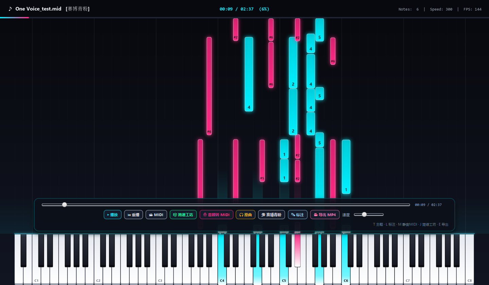

# Piano Waterfall Java



JavaFX 桌面版钢琴瀑布流（Synthesia 风格）。MIDI 会被解析成带真实时间戳的音符，
以霓虹光柱沿 88 键钢琴下落；内置简谱编译器、原曲同步、AI 扒谱桥接和 60 FPS
离线 MP4 导出。

## 功能

- **88 键 3D 琴键**：52 白键 / 36 黑键自适应居中，白键象牙渐变、黑键高光，
  按下时出现主题色渐变和向上激光光柱。
- **霓虹瀑布**：白键音符青、黑键音符洋红，圆角、描边、光晕、内部高光；
  触键粒子爆发、长音持续火星、呼吸判定线。
- **可视化 HUD**：曲名、主题、时间 / 总时长 / 百分比、活跃音符数、实时 FPS。
- **底部悬浮控制坞**：播放 / 暂停、可拖动进度条、重播、打开 MIDI、简谱工坊、
  音频转 MIDI、原曲、主题、标注、导出 MP4、下落速度；鼠标静止 3 秒自动淡出。
- **4 套主题**：赛博青粉、极光翠绿、鎏金琥珀、星光樱粉，按 `T` 循环切换。
- **简谱工坊**：双轨简谱文本、调号 C–B、BPM，一键编译成 MIDI 并立即播放。
- **原曲同步**：加载 MP3 / WAV 作为主时钟，与 MIDI 音符同步；`M` 可静音 MIDI
  合成器只听原曲。
- **AI 扒谱**：调用本地 Python 的 hFT / CRNN 转录，或 basic-pitch、
  `piano_transcription_inference`，生成 MIDI 后自动载入。
- **MP4 导出**：固定 1/60 秒步长离线渲染，需要本机 `ffmpeg`。

## 环境

- JDK 21 或更高版本（开发环境 JDK 25）。
- Maven 3.9+。
- 导出 MP4 需要 `ffmpeg` 在 `PATH` 中。
- AI 扒谱需要 Python 3.10+，并安装本项目 Python 版或 basic-pitch（可选）。

## 构建与运行

```bash
mvn -q -DskipTests compile
mvn -q test
mvn org.openjfx:javafx-maven-plugin:0.0.8:run
```

在 IntelliJ IDEA 中直接运行 `com.piano.waterfall.Launcher` 即可（比运行 `App`
更不容易遇到 JavaFX 模块错误）。

打包：

```bash
mvn -q package
java --add-opens=java.desktop/com.sun.media.sound=ALL-UNNAMED \
  -cp "target/classes;target/Piano_Waterfall_Java.ver-1.1.0.jar;$(cat cp.txt)" \
  com.piano.waterfall.Launcher
```

`cp.txt` 可由 `mvn dependency:build-classpath -Dmdep.outputFile=cp.txt` 生成。

## 快捷键

| 按键 | 功能 |
| --- | --- |
| `Space` | 暂停 / 继续 |
| `←` / `→` | 快退 / 快进 5 秒 |
| `R` | 从头重播 |
| `T` | 切换主题 |
| `L` | 显示 / 隐藏音符上的简谱标注 |
| `M` | 静音 / 恢复 MIDI 合成器 |
| `J` | 打开简谱工坊 |
| `O` | 打开本地 `.mid` 文件 |
| `E` | 导出 60 FPS MP4 |
| `F11` | 全屏切换 |

## 主题

| 主题 | 主色 | 次色 |
| --- | --- | --- |
| 赛博青粉 | `#00F0FF` | `#FF2A85` |
| 极光翠绿 | `#00FF9D` | `#7000FF` |
| 鎏金琥珀 | `#FFB800` | `#FF3D00` |
| 星光樱粉 | `#FF75B5` | `#7A88FF` |

## AI 扒谱（可选）

点击「音频转 MIDI」选择 MP3 / WAV / FLAC，程序会依次尝试：

1. 本项目的 Python 转录包 `piano_waterfall.transcribe`（hFT-Transformer）；
2. `basic-pitch` 命令行；
3. `piano_transcription_inference`。

若 Python 不在默认 PATH，可指定解释器：

```bash
java -Dpiano.python="C:/path/to/.venv/Scripts/python.exe" ...
```

Python 端安装示例（在 Python 项目根目录）：

```bash
pip install -e .
# 或
pip install basic-pitch
```

## 原曲同步

点击「原曲」选择与 MIDI 对应的 MP3 / WAV。音频会成为主时钟，MIDI 合成器默认
静音；再按一次「移除原曲」或按 `M` 切回 MIDI 音色。

## 音色

默认使用 JDK 自带的 Gervill 合成器。把任意 `.sf2` 钢琴音色放到
`src/main/resources/soundfont/piano.sf2`，启动时会自动加载；没有该文件时使用
默认音色。也可以在命令行用 `piano.audio` 指定原曲，用 `piano.theme` 指定主题。

## 导出 MP4

按 `E` 选择输出位置。导出使用固定 1/60 秒步长离线渲染，画面与 WAV 音轨严格
对齐，不依赖实时帧率。WAV 由 `SoftSynthesizer.openStream` 反射生成，因此需要：

```text
--add-opens=java.desktop/com.sun.media.sound=ALL-UNNAMED
```

`pom.xml` 的 `javafx-maven-plugin` 已配置该参数；IDEA 运行 `Launcher` 时请把它
加入 VM options。若 `ffmpeg` 不在 `PATH`，程序会提示导出失败，实时播放不受影响。

## 可配置系统属性

| 属性 | 说明 |
| --- | --- |
| `-Dpiano.size=1440x840` | 初始窗口尺寸 |
| `-Dpiano.theme=CYBERPUNK` | 启动主题：`CYBERPUNK` / `AURORA` / `GOLDEN` / `SAKURA` |
| `-Dpiano.audio=path.wav` | 启动时加载原曲并与 MIDI 同步 |
| `-Dpiano.snapshot=out.png` | 启动 12 秒后保存整窗截图并退出（CI/文档） |
| `-Dpiano.export=out.mp4` | 启动 2 秒后自动导出并退出（需要 ffmpeg） |
| `-Dpiano.python=python.exe` | AI 扒谱使用的 Python 解释器 |

## 项目结构

```text
src/main/java/com/piano/waterfall/
├── Launcher.java              # 入口（避免 IDEA 的 JavaFX 模块错误）
├── App.java                   # 主窗口、悬浮控制坞、快捷键、渲染循环
├── model/
│   ├── NoteBlock.java         # 音符 record
│   └── KeyGeometry.java       # 88 键几何
├── midi/
│   ├── MidiParser.java        # Tick → 秒，支持变速
│   ├── ScoreCompiler.java     # 简谱 → MIDI Sequence
│   ├── AudioEngine.java       # Sequencer + Synthesizer + 原曲同步
│   └── AudioTranscriber.java  # 调用 Python / basic-pitch 扒谱
├── render/
│   ├── WaterfallRenderer.java # 主题、3D 键盘、HUD、粒子
│   └── ParticleSystem.java    # 触键粒子
├── ui/
│   └── JianpuStudioDialog.java# 简谱工坊
└── export/
    └── VideoExporter.java     # 60 FPS MP4 导出
```

## 说明

- 这是 MIDI 播放器；AI 扒谱是可选的本地 Python 桥接，不装 Python 时其他功能
  不受影响。
- 音频质量取决于系统合成器；需要更真实的钢琴音色时请放入 `.sf2` 音色库。
- 导出依赖 ffmpeg，未安装时导出会提示失败，实时渲染与播放正常。
